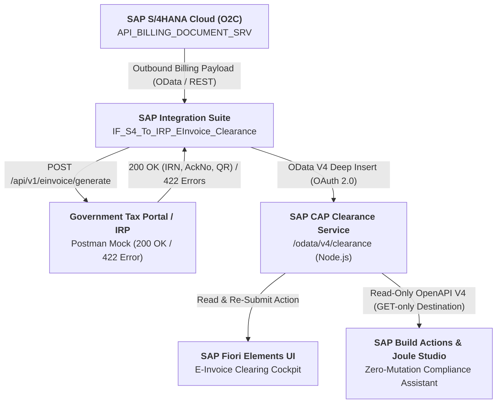
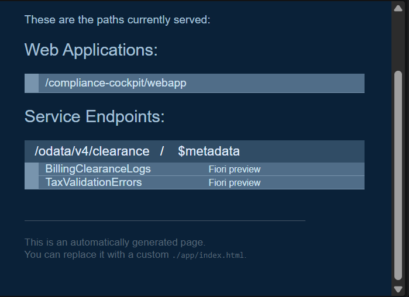
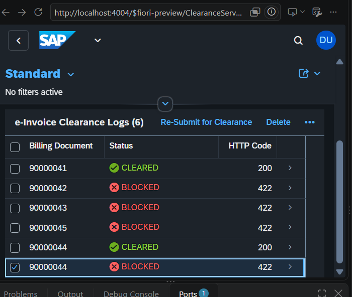
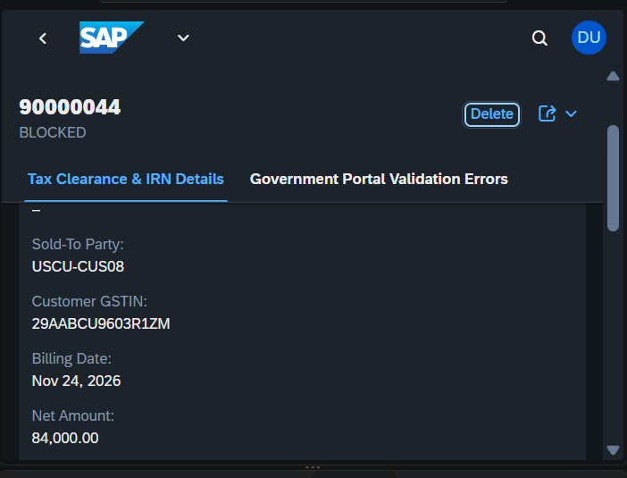
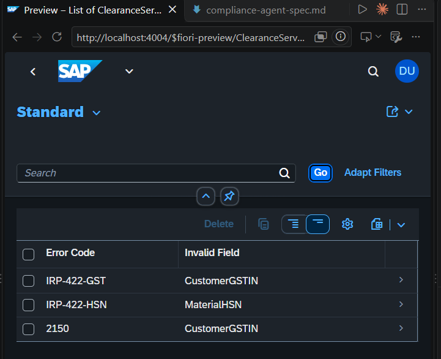
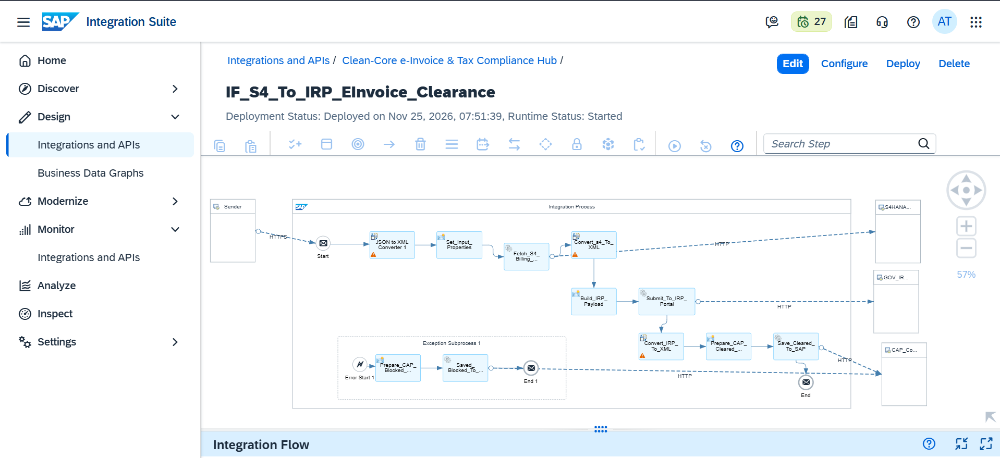
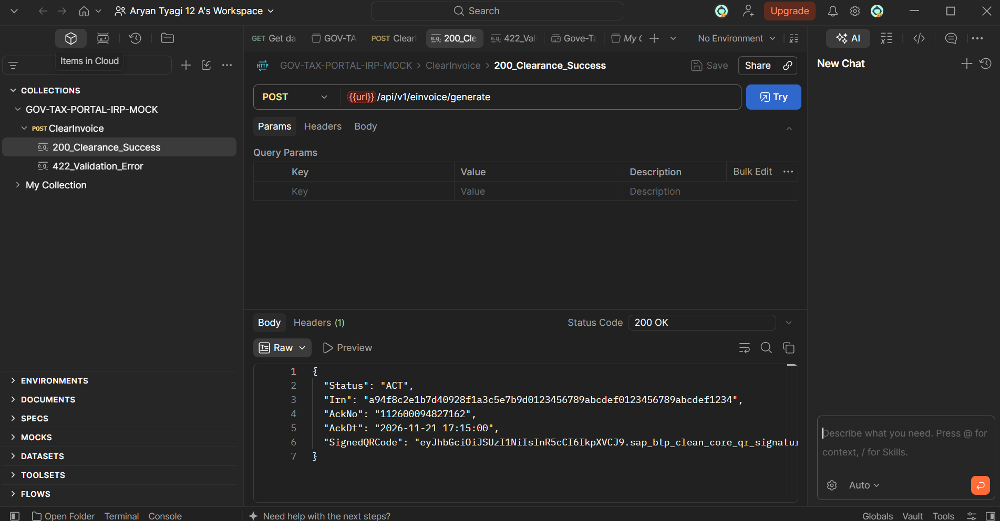
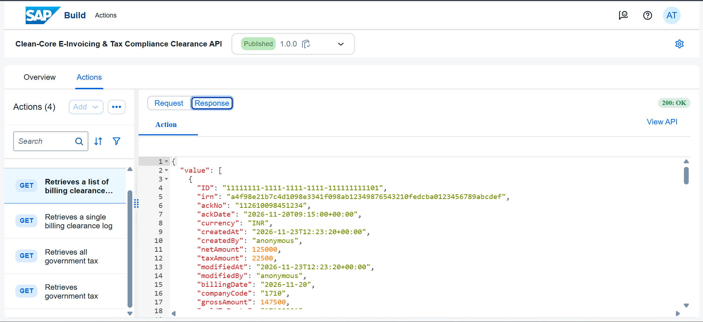

# Clean-Core E-Invoicing & Tax Compliance Clearing Hub (SAP S/4HANA Order-to-Cash Extension)

[](https://lnkd.in/p/gaYBkGd8)


A side-by-side **SAP BTP Clean-Core** extension for SAP S/4HANA Cloud Order-to-Cash (O2C) billing compliance. Instead of modifying core S/4HANA billing user exits (`RV60AFZZ`), this architecture decouples government Invoice Registration Portal (IRP) clearance, tax validation error handling, operational exception resolution, and AI-assisted compliance auditing onto SAP BTP.

---

## End-to-End Architecture



---

## Live Execution & UI Walkthrough

### 1. SAP CAP OData V4 Service & Fiori Elements Clearing Cockpit
CAP runtime endpoints (`/odata/v4/clearance`) serving the Fiori Elements List Report (`CLEARED` vs. `BLOCKED` billing documents with one-click `Re-Submit for Clearance`), Object Page details (`90000044`), and deep-inserted field-level `TaxValidationErrors`:









### 2. SAP Integration Suite iFlow & Exception Subprocess
Deployed and running `IF_S4_To_IRP_EInvoice_Clearance` orchestration routing `200 OK` clearances and intercepting HTTP `422` errors via `Exception Subprocess 1`:



### 3. Deterministic Government IRP Mock (Postman)
Simulated IRP endpoint (`POST {{url}}/api/v1/einvoice/generate`) modeling `200_Clearance_Success` (IRN, AckNo, Signed QR) and `422_Validation_Error` payloads:



### 4. Governed Read-Only SAP Build Actions (`v1.0.0`)
Published SAP Build Action Library exposing only four sanitized OData V4 `GET` endpoints with a verified `200: OK` response payload for the Joule Studio Compliance Assistant:



---

## Core Capabilities & Clean-Core Design

### 1. Event-Driven Integration Orchestration (`integration-suite/`)
- **Artifact:** `IF_S4_To_IRP_EInvoice_Clearance.zip` (Package: *Clean-Core e-Invoice & Tax Compliance Hub*).
- **200 OK Clearance Path:** Transforms S/4HANA billing data into the government e-invoice schema, invokes the IRP endpoint, captures the 64-character **IRN**, **Acknowledgment Number**, **Acknowledgment Date**, and **Signed QR Code**, and persists a `CLEARED` record in SAP CAP.
- **422 Validation Exception Path:** Intercepts HTTP `422 Unprocessable Entity` responses via an Exception Subprocess, correlates the **CPI Message GUID** (`SAP_MessageProcessingLogID`), and executes an OData V4 deep insert (`BillingClearanceLogs` + child `TaxValidationErrors`) so billing specialists see exact field-level diagnostics without checking CPI monitors.
- **Security:** Authenticated via SAP BTP XSUAA OAuth 2.0 Client Credentials.

### 2. Deterministic Government Tax Portal Mock (`postman/`)
- **Artifact:** `GOV-TAX-PORTAL-IRP-MOCK.postman_collection.json`.
- Models `POST {{url}}/api/v1/einvoice/generate` with saved response examples for both **`200_Clearance_Success`** (`Status: "ACT"`, IRN, AckNo, SignedQRCode) and **`422_Validation_Error`** (e.g., error code `2150` on `CustomerGSTIN`).

### 3. SAP CAP Backend & Fiori Elements Clearing Cockpit (`db/`, `srv/`, `app/`)
- **Data Model (`db/`):** CDS entities `BillingClearanceLogs` and composition `TaxValidationErrors` with status criticality annotations (`CLEARED`, `BLOCKED`).
- **OData V4 Service (`srv/`):** Exposes `/odata/v4/clearance` with deep-insert persistence and a bound `reSubmit` action for re-triggering clearance once S/4HANA Business Partner (`BP`) master data is corrected.
- **Fiori Elements UI (`app/compliance-cockpit/`):** List Report and Object Page cockpit displaying clearance statuses, IRN metadata, tax validation error tables (`errorCode`, `errorField`, `errorMessage`, `remediationHint`), and single-click re-submission.

### 4. Governed SAP Build Actions & Joule Studio Copilot (`joule-studio/`)
- **Importable Action Archive (`Clean-Core E-Invoicing & Tax Compliance Clearance API_1.0.0.mtar`):** Released and published `v1.0.0` SAP Build Action Library package ready for import into any SAP Build Lobby connected via BTP Destination `CAP_CLEARANCE_COCKPIT` (`sap.applicationdevelopment.actions.enabled = true`).
- **Least-Privilege OpenAPI Contract (`einvoice-clearance-openapi.json`):** Strictly sanitized to expose only four read-only `GET` endpoints (`/BillingClearanceLogs`, `/BillingClearanceLogs({ID})`, `/BillingClearanceLogs({ID})/errors`, `/TaxValidationErrors`). All `POST`, `PATCH`, `DELETE`, `/$batch`, and `reSubmit` operations are stripped so the AI agent cannot mutate financial or compliance state.
- **Joule Studio Agent Specification (`compliance-agent-spec.md`):** Turnkey system prompt, tool-routing rules, zero-hallucination guardrails, and CPI Message GUID traceability ready for deployment on an entitled `das-application` subaccount.

---

## Repository Structure

```text
clean-core-einvoice-hub/
├── app/
│   └── compliance-cockpit/                                                   # SAP Fiori Elements List Report & Object Page UI
├── db/                                                                       # SAP CAP CDS domain schema & sample seed data
├── srv/                                                                      # OData V4 service definitions & custom handlers
├── docs/
│   └── screenshots/                                                          # End-to-end execution & UI screenshots
├── integration-suite/
│   └── IF_S4_To_IRP_EInvoice_Clearance.zip                                   # Deployable SAP Cloud Integration iFlow
├── postman/
│   └── GOV-TAX-PORTAL-IRP-MOCK.postman_collection.json                       # IRP mock API collection (200 OK & 422 Error)
├── joule-studio/
│   ├── Clean-Core E-Invoicing & Tax Compliance Clearance API_1.0.0.mtar      # Published SAP Build Action Library archive
│   ├── compliance-agent-spec.md                                              # Joule Studio system instructions & tool bindings
│   └── einvoice-clearance-openapi.json                                       # Sanitized read-only OData V4 OpenAPI spec
├── einvoice-clearance-openapi.json                                           # Root OpenAPI V4 contract for SAP Build Actions
└── package.json                                                              # SAP CAP Node.js project configuration
```

---

## Local Quickstart

```bash
# 1. Install dependencies
npm install

# 2. Start the local CAP OData V4 server and Fiori Elements preview
npx cds watch
```

Open `http://localhost:4004` to launch the **e-Invoice Clearance Log** Fiori Elements cockpit and inspect the `/odata/v4/clearance` service endpoints.